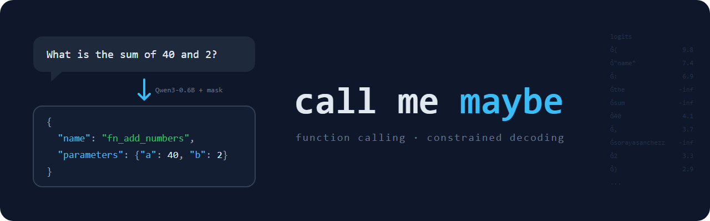

*This project has been created as part of the 42 curriculum by sosanche.*

# call me maybe



## Description

A question in plain English goes in. A **function call** comes out.

```
"What is the sum of 2 and 3?"   ──►   fn_add_numbers  {"a": 2.0, "b": 3.0}
```

The program does **not** answer the question. It only picks **which function** to call and **with which values**.

It uses a small model (**Qwen3-0.6B**) with **constrained decoding**: at every step, the model can only pick tokens that keep the output valid. So the name always exists, the types are always right, and the JSON is always valid.

## Instructions

```bash
make install      # uv sync
make run          # uses the default files below
```

Custom files:

```bash
uv run python -m src --functions_definition <file> --input <file> --output <file>
```

| Option                   | Default                                       |
|--------------------------|-----------------------------------------------|
| `--functions_definition` | `data/input/functions_definition.json`        |
| `--input`                | `data/input/function_calling_tests.json`      |
| `--output`               | `data/output/function_calling_results.json`   |

| Rule               | Does                              |
|--------------------|-----------------------------------|
| `make debug`       | runs with `pdb`                   |
| `make clean`       | removes caches                    |
| `make lint`        | `flake8` + `mypy`                 |
| `make lint-strict` | `flake8` + `mypy --strict`        |

## Example usage

```
$ make run
What is the sum of 2 and 3? -> fn_add_numbers {'a': 2.0, 'b': 3.0}
Greet shrek -> fn_greet {'name': 'shrek'}
Reverse the string 'hello' -> fn_reverse_string {'s': 'hello'}
...
Results written to data/output/function_calling_results.json
```

Output file:

```json
{
  "prompt": "What is the sum of 2 and 3?",
  "name": "fn_add_numbers",
  "parameters": {"a": 2.0, "b": 3.0}
}
```

Errors are clean, never a traceback:

```
$ uv run python -m src --input nope.json
Error: file not found: nope.json
```

## Algorithm explanation

```
 JSON files ──► pydantic check ──► choose name ──► write params ──► json.dump
 file_reader      models.py     function_chooser  parameter_writer  file_writer
```

**1. Read** · `file_reader.py` loads both files, `models.py` validates them with pydantic. Bad file → clear error, before loading the model.

**2. Vocabulary** · the text of every token is saved once, so I know what each token writes.

**3. Function name** · `function_chooser.py`
- The prompt (Qwen chat format + function list + question) ends with `{"name": "`
- For each step, only tokens that keep the text as **the start of a real name** are allowed (`fn_ad` + `d` ✓, `fn_ad` + `x` ✗).
- Among those, the highest logit wins.
- When only one name is still possible, it is written directly (fewer model calls).

**4. Parameters** · `parameter_writer.py`, one parameter at a time:

| Type      | Allowed tokens                         | Stops when                      |
|-----------|----------------------------------------|---------------------------------|
| `number`  | digits, `.`, `-` (must stay valid)     | `,` or `}` and number complete  |
| `integer` | digits, `-`                            | same                            |
| `boolean` | only `true` / `false`                  | word complete                   |
| `string`  | any (first one must start with `"`)    | closing `"` (not `\"`)          |

Strings are written JSON-style by the model and decoded with `json.loads`.

**5. Save** · `file_writer.py` writes everything with `json.dump` → always valid JSON.

## Design decisions

- **Step by step** (name, then each parameter) instead of a full JSON state machine: shorter and easier to read.
- **One number writer** for `number` and `integer`, only the allowed characters change.
- **`choose_word` reused** for function names and for `true` / `false`.
- **Chat format + one invented example** (a function not in the tests): fewer mistakes, no hardcoded answers.
- **Fail early:** output file and parameter types are checked before loading the model.
- **Never crash:** every error ends with a message and `sys.exit`.
- **Lint config** skips `.venv/` and `llm_sdk/` (not my code).
- No bonus

## Performance analysis

| | |
|---|---|
| **Accuracy**    | 11/11 on the example files · 11/11 on another project's tests · 11/11 on the moulinette's private prompts |
| **Speed**       | 2–3 min for 11 prompts on CPU (limit: 5 min). ~1.4 s per model call, my code < 0.1 s |
| **Reliability** | always valid JSON, name always exists, every value has the right type |

## Challenges faced

| Problem | Fix |
|---|---|
| Model skipped the first char of strings (`home/...` instead of `/home/...`) | let the model write the opening `"` itself |
| `"` inside strings became `'` | the example prompt contains an escaped `\"` |
| Wrong function on new files | Qwen chat format + function descriptions |
| "replace all numbers" → wrote a word, not a regex | instruction: write values in the form the parameter needs |
| `Ñ` became `��` | decode all string tokens together, not one by one |
| Long numbers were cut | token limit for numbers raised from 20 to 100 |
| mypy errors from `llm_sdk` | excluded in `pyproject.toml` |

## Testing strategy

- Example files in `data/input/`, every result checked by hand.
- Test files from another project, with unknown functions → nothing hardcoded.
- Error cases: missing file, invalid JSON, empty prompt list, output folder that does not exist.
- `make lint` and `make lint-strict` pass with no errors.

## Quick check for evaluation

```bash
make install
make lint-strict                                  # no errors
make run                                          # ~2-3 min
cat data/output/function_calling_results.json     # valid JSON
uv run python -m src --input nope.json            # clean error
```

## Resources

- [Qwen3-0.6B](https://huggingface.co/Qwen/Qwen3-0.6B)
- [Efficient Guided Generation for LLMs](https://arxiv.org/abs/2307.09702) (constrained decoding)
- [pydantic](https://docs.pydantic.dev/) · [mypy](https://mypy.readthedocs.io/) · [flake8](https://flake8.pycqa.org/) · [uv](https://docs.astral.sh/uv/)

## AI usage

I've used ChatGPT to:

- Theory: help me understand the logic; above all, it's helped me with regex and the structure of Qwen.

I've used Claude to:

- Run tests: I've asked it to run normal tests and edge-case tests; thanks to that, I've found errors such as the problem with /, the issue with ¨, and special characters...
- Speed tips: like having it show type errors earlier to save time.
- To generate the basic `make help` output
- Readme: to help me organize and structure the readme, as well as make it more visual.
